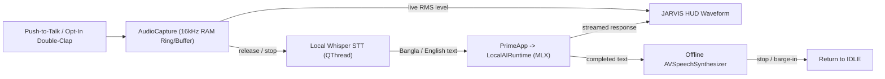

# PRIME Voice Architecture (Phase 05)

## 1. Design Principles

- **100% Local Audio & Speech:** Microphone capture, transient clap analysis, speech-to-text, and text-to-speech run strictly on-device with zero cloud endpoints.
- **Zero Raw Audio Persistence:** Captured PCM audio stays in bounded RAM arrays for active transcription only and is zeroed/released immediately after `STTProvider.transcribe_pcm()` finishes or cancels.
- **Non-Blocking UI Thread:** Audio capture callbacks (`sounddevice.InputStream`), STT decoding, and TTS synthesis run off the Qt GUI thread (`QThread` workers + Qt signals).
- **8 GB M1 Memory Safety:** Lazy-load STT weights on demand and support unloading/swapping cleanly alongside `qwen2.5-1.5b-4bit` (~`1.24 GB` peak MLX).

---

## 2. Module Layout (`src/prime/voice/`)

```
src/prime/voice/
├── __init__.py
├── contracts.py            # Existing SpeechLanguage, AudioPolicy, STT/TTS protocols, ActivationSnapshot
├── permissions.py          # Non-prompting macOS TCC Microphone check + explicit request helper
├── audio_capture.py        # Bounded sounddevice 16kHz mono capture + RMS waveform telemetry
├── double_clap.py          # Opt-in RMS transient double-clap detector (zero storage, no wake-word)
├── stt/
│   ├── __init__.py
│   ├── registry.py         # Approved local STT model catalog under models/stt/
│   └── whisper_provider.py # Local offline Whisper STT provider (load, transcribe, cancel, unload)
└── tts/
    ├── __init__.py
    └── avspeech_provider.py # macOS AVSpeechSynthesizer offline TTS (English + Bangla Piya, rate, volume, stop)
```

---

## 3. End-to-End Voice Pipeline Flow



---

## 4. State Machine Integration

`AssistantState` extends cleanly with `TRANSCRIBING`:
- `IDLE` -> `LISTENING` (Push-to-Talk active) -> `TRANSCRIBING` (Whisper running locally) -> `THINKING` / `SPEAKING` -> `IDLE`.
- Double-clap monitoring operates only when explicitly opted in by the user (`double_clap_enabled=True` AND user clicks/enables active monitoring in Settings/HUD) and displays a persistent `"MIC MONITORING: DOUBLE-CLAP"` indicator while active.
